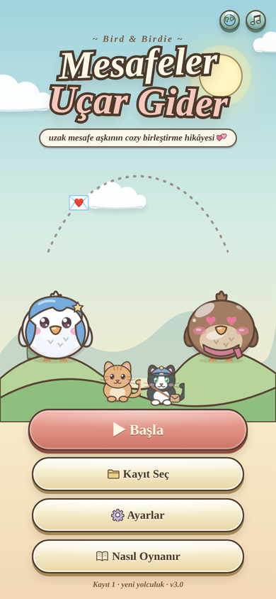
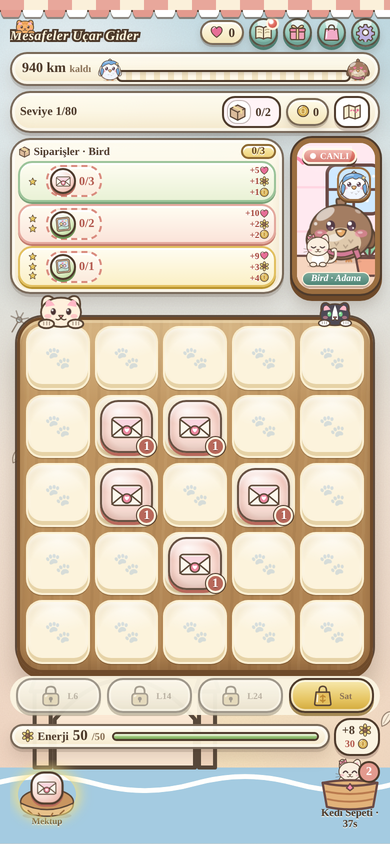
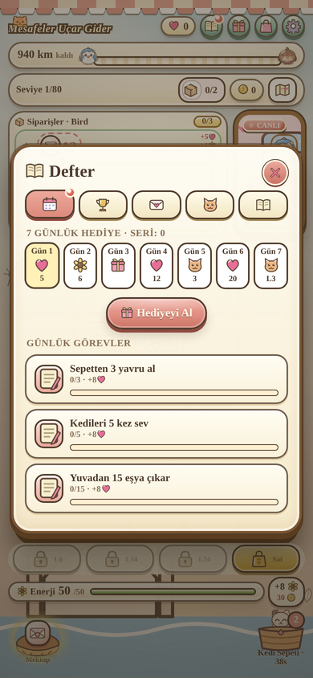
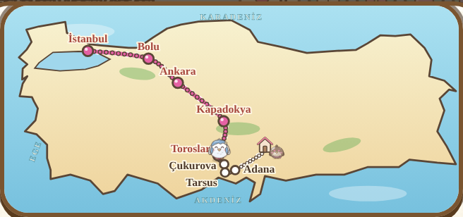

<div align="center">


# Mesafeler Uçar Gider

**Bird & Birdie'nin uzak mesafe aşkını anlatan cozy bir mobil birleştirme (merge) oyunu.**

İstanbul ile Adana arasındaki 940 km'yi mektuplar, çiçekler ve bol kediyle kapat.

### [▶ Demoyu oyna](https://bmihci.github.io/mesafeler-ucar-gider/)

*Telefonda en iyi sonucu verir · Türkçe / English · kurulum gerektirmez*

<br>

&nbsp;
&nbsp;




</div>

## Oyun hakkında

Bird Adana'da, Birdie İstanbul'da. Aynı eşyaları birleştirerek siparişleri tamamlar, kalp kazanır ve iki kuşu adım adım birbirine yaklaştırırsın. Hangi kuşla yola çıkacağını sen seçersin; yolculuk Türkiye haritası üzerinde 8 şehirden geçer.

## Özellikler

- **80 seviyelik yolculuk** — her 10 seviyede yeni bölge, yeni tema ve yeni arka plan (Boğaz, orman, bozkır, Kapadokya, Toroslar, Çukurova…)
- **Birleştirme tahtası** — 7 eşya ailesi, her biri 6 kademe; aynı anda 3 sipariş
- **Kediler** — kedi sepeti, kedili özel seviyeler ve tahtada dolaşan yardımcılar
- **Defter** — 7 günlük hediye serisi, günlük görevler, koleksiyon albümü, mektuplar
- **Hediye kodu** — partnerine kısa bir kodla (`PK-XXXXX-XXXXX`) hediye gönder
- **Mağaza** — jokerler, şapkalar, tahta ve yuva görünümleri, kalıcı yükseltmeler, altın/enerji paketleri (şimdilik test satın alma)
- **5 görünüm teması** — Suluboya Masal, Şeker, Kiraz Çiçeği, Eskiz Defteri, Gece Feneri; tema tüm arayüzü, ikonları ve arka planı değiştirir
- **Reklam altyapısı** — ödüllü reklam ve alt banner, Google'ın test reklam birimleriyle
- **Tamamı çizim** — ikonlar, kuşlar, kediler ve harita kod içinde SVG olarak çizildi; harici görsel dosyası yok
- **Çevrimdışı çalışır (PWA)** — ana ekrana eklenebilir; ilerleme cihazda saklanır, 3 kayıt yuvası
- **Pil tasarrufu modu** — telefonda animasyon ve efektleri hafifletir

## Teknik

Framework ya da bağımlılık yok: tek bir `index.html` (HTML + CSS + JavaScript), service worker ve manifest.

| Yol | İçerik |
| --- | --- |
| `index.html`, `sw.js`, `manifest.webmanifest`, ikonlar | Yayınlanan oyun — depo kökü doğrudan statik site olarak sunulabilir |
| `src/` | Kaynak parçalar (stil, gövde, çekirdek, çizimler, oyun, saga, ekonomi, sistemler) |
| `build.sh` | `src/` parçalarını birleştirip `index.html` üretir ve sözdizimini denetler |
| `tools/` | Playwright ile yazılmış oyun botu ve denetim betikleri (`audit.js`, `v15check.js`, `shots.js`) |
| `README.txt` | Sürüm notları |

```bash
bash build.sh        # src/ -> index.html
```

Yerelde denemek için `index.html` dosyasını tarayıcıda açmak yeterli; PWA özellikleri için herhangi bir statik sunucu (`python3 -m http.server`) kullanılabilir.

## Sürümler

Güncel sürüm **v15**, `main` dalında. Eski sürümler ayrı dallarda duruyor: `surum/v2`, `surum/v3`, `surum/v8`, `surum/v9`, `surum/v10`, `surum/v14`.

## Durum

Oyun geliştirme aşamasında; denge ve seviye tasarımı hâlâ değişiyor. Geri bildirim için [Issues](../../issues) bölümünü kullanabilirsin.

---

**English** — *Distances Fly Away* is a cozy long-distance-love merge game for mobile browsers. Merge items, fill orders and bring Bird and Birdie together across an 80-level journey over a map of Turkey. Single-file HTML5, no dependencies, works offline as a PWA, playable in Turkish and English. **[Play the demo](https://bmihci.github.io/mesafeler-ucar-gider/)**

© BMihci — Tüm hakları saklıdır / All rights reserved.
